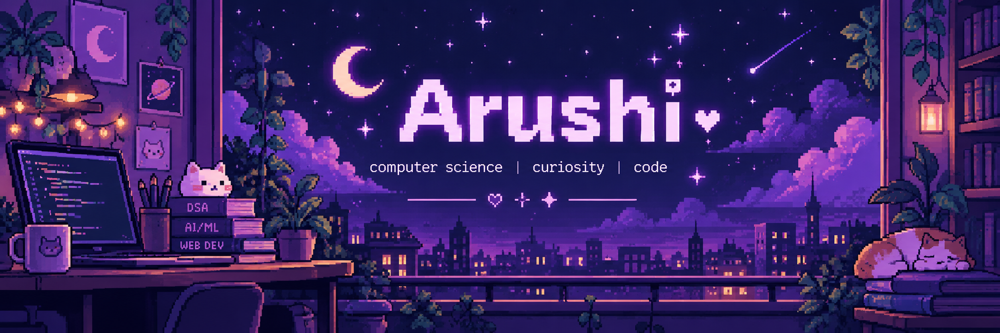

 

`☾` &nbsp; `✦` &nbsp; `⋆｡°✩` &nbsp; `☁` &nbsp; `✧` &nbsp; `☾`

*building my future, one little commit at a time.*

---

## ☾ a little about me

hi, i'm **arushi** — a third-year computer science undergraduate who loves exploring how technology works and turning ideas into things that actually do something.

i'm interested in the intersection of problem-solving, intelligent systems, and software development. i'm still learning, still experimenting, and slowly building my own corner of the tech universe.

- ✧ studying computer science and engineering
- ✧ exploring artificial intelligence and machine learning
- ✧ practicing data structures and algorithms
- ✧ building projects that mix creativity with code
- ✧ always curious about what i can make next

> *a curious mind, a messy notebook, and approximately 47 open tabs.*

---

## ✧ things i work with

  <strong>languages</strong> 
  

  <strong>web &amp; development</strong> 
  

  <strong>my tools</strong> 
  

---

## ☁️ little things i've been building

  <i>little ideas, late-night coding, and things I'm learning to bring to life.</i>

<table>
<tr>
<td width="50%" valign="top">

<h3>
  
</h3>

  Exploring speech analysis using audio processing and machine learning.
  The project investigates acoustic features and speech representations
  to understand voice characteristics.

  
  
  

✦ AUDIO PROCESSING · MACHINE LEARNING

</td>
<td width="50%" valign="top">

<h3>
  
</h3>

  A cute browser game where players collect flowers, race against
  the timer, and try to beat their best score.
  A little experiment in interactive web development.

  
  
  

✦ WEB DEVELOPMENT · GAME LOGIC

</td>
</tr>
<tr>
<td colspan="2" valign="top">

<h3>
  
</h3>

  A student-focused platform concept for exchanging and reusing
  books and academic resources. Exploring ways to make learning
  materials more accessible to students.

  
  
  

✦ FULL-STACK DEVELOPMENT · PROJECT CONCEPT

</td>
</tr>
</table>

 

 

☾ making things, learning things, getting a little better every day ✦

---

## 🌌 my GitHub corner

 

☾ quietly building, learning, and getting better with every commit ✦

---

## 💌 find me elsewhere

  

*thanks for wandering through my little universe.*

`made with ♡, curiosity, and a little moonlight`

